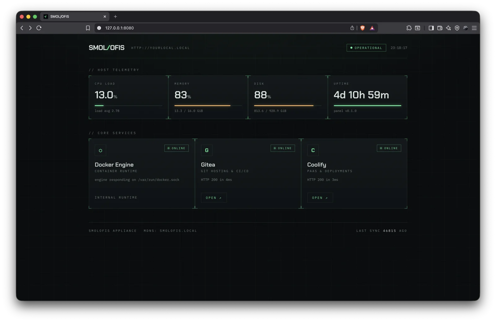

# 📦 SmolOfis

> The "smol" infrastructure appliance for agile web teams. No cloud tax. No enterprise bloat. Just pure developer autonomy.

SmolOfis is a custom, lightweight, headless Linux operating system appliance designed to turn any spare x86 hardware — a NUC, an N100 mini-PC, a retired desktop — into a fully automated, self-hosted DevOps hub for small engineering teams.

Instead of fighting complex configuration scripts or heavy enterprise monoliths, SmolOfis flashes as a single ISO, boots instantly, and exposes a high-performance management dashboard built entirely in Rust.



---

## 🛠️ The Tech Stack

- **OS Base:** Minimal, headless Debian 13 "trixie" rootfs (debootstrap `minbase`) configured for appliance stability.
- **Control Plane:** Compiled Rust binary using `axum` (async web engine), `sysinfo` (telemetry), and `askama` (compiled, type-safe HTML templates) with Tailwind CSS.
- **Git & CI/CD:** Native Gitea integration paired with Gitea Actions for syntax-compatible GitHub pipeline workflows.
- **Orchestration (PaaS):** Coolify engine for managing automated branch-based builds, databases, and multi-server deployments.
- **Networking & Discovery:** Built-in Avahi (`smolofis.local` mDNS resolution) with zero-config DHCP via NetworkManager, and native Tailscale integration for secure mesh remote access.

---

## 🏗️ Architecture & Boot Sequence

When you power on a machine running SmolOfis, it coordinates initialization gracefully via `systemd`:

1. **Kernel Bootstrap:** The stripped-down kernel boots and brings up core networking targets.
2. **Instant UI Panel:** A specialized systemd service launches the `smolofis-panel` Rust binary on port `8090`. It immediately serves a responsive "System Initializing..." interface.
3. **Daemon Initialization:** Background systemd workers launch the Docker engine and network discovery layers (`avahi-daemon`).
4. **App Ecosystem Spin-up:** Docker automatically starts Traefik, then the pre-configured Gitea, Coolify and self-registering Gitea Actions runner.
5. **Dashboard Transition:** The Rust panel polls the core services locally. Once they pass health checks, the UI shifts smoothly to the operational management cockpit.

---

## 🔐 Operator Access & Administration

SmolOfis boots headless but provides full local console and SSH access:

- **Default User:** `smolofis`
- **Default Password:** `smolofis` (expired: you must choose a new one at first login, and it persists on an installed disk)
- **Privileges:** Passwordless `sudo` rights
- **Gitea & Coolify Logins:** Generated per device and claimed before the LAN can reach them. Read them with `sudo smolofis-admin show`. Open registration is off on both.
- **SSH Port:** `22` (`ssh smolofis@smolofis.local`)
- **Port & Ingress Allocation:**
  - Control Panel: `http://smolofis.local` (Traefik on port `80`). Port `8090` serves it directly on the USB image and while the stack starts, then closes to the LAN.
  - App Ingress: Traefik, managed by Coolify, owns ports `80` and `443`. An app needs a domain that resolves to the appliance, such as a real DNS name or `<app>.<ip>.sslip.io`. mDNS cannot resolve subdomains like `app.smolofis.local`.
  - Unclaimed hostnames and direct IP access land on the panel.
  - Gitea Web & API: `http://smolofis.local:3000`
  - Coolify PaaS Console: `http://smolofis.local:8000`
  - Git over SSH: port `2222`

---

## 🖥️ Hardware Requirements

- **CPU:** x86-64. A recent mini-PC such as an Intel N100 is the target.
- **Memory:** 4 GiB minimum, 8 GiB recommended. The full stack is tested with 6 GiB.
- **Storage:** 32 GiB minimum on an internal SSD. The system partition takes about 8.5 GiB, and the rest holds your data. 128 GiB or more is sensible for real use.
- **Network:** wired Ethernet with DHCP. Wi-Fi is not configured.
- **Firmware:** UEFI or legacy BIOS. **Turn Secure Boot off**, because the bootloader is not signed for it.

---

## 💾 Installing SmolOfis to Internal Disk

SmolOfis boots as a live image from USB for trying the panel and running the installer. The Gitea and Coolify stack needs a data partition, so it only starts after installing; on the USB image the panel is at `http://smolofis.local:8090` and shows `LIVE MODE`. To permanently install the appliance onto your hardware's internal NVMe or SATA SSD:

1. Boot your machine from the flashed USB stick.
2. Log in locally or via SSH (`ssh smolofis@smolofis.local`).
3. Run the interactive disk installer:
   ```bash
   sudo smolofis-install
   ```
4. Select your target drive (e.g. `/dev/nvme0n1`). The installer will automatically format the disk with UEFI and legacy BIOS bootloaders, the immutable system partition, and a persistent data partition for your Gitea repos and Docker volumes.
5. Reboot and unplug the USB drive.

For non-interactive or automated provisioning:
```bash
sudo smolofis-install --disk /dev/nvme0n1 --yes
```

---

## 🔄 Upgrading

Over the network:

```bash
smolofis-update check                 # compare with the latest release
sudo smolofis-update apply            # verify, back up, install, reboot
smolofis-update status                # version, booted slot and active slot
```

Add `--channel nightly` to either command to follow `main`. Updates must be signed by the release key, and only newer versions are accepted. The new version goes into the unused system slot and boots once. It becomes active after the stack reports ready; otherwise the appliance returns to the previous slot.

Rollback restores the system, not your data. If Gitea or Coolify migrated their databases before the failure, restore the backup that `apply` took: `sudo smolofis-backup restore <name> --yes`.

Without network access, flash the newer ISO to a USB stick, boot from it, and run:

```bash
sudo smolofis-install --upgrade --disk /dev/nvme0n1
```

This replaces the active system and leaves your repositories, deployments, password and SSH keys alone. Remove the USB drive and reboot. A USB upgrade has no automatic rollback, so take a backup first.

Stack changes ship with the image, so `/etc/smolofis/docker-compose.yml` is replaced on every boot. Put local changes in `/etc/smolofis/docker-compose.override.yml`.

---

## 🩺 Troubleshooting

`sudo smolofis-support` writes a bundle of logs and system state to `/var/lib/smolofis`. It leaves out the files that hold secrets, but read it before sharing, because logs can name hosts and users.

---

## 💼 Backups

A nightly job archives Gitea, Coolify and the device's secrets to `/var/lib/smolofis/backups`, keeping the last 7. Gitea stops for a short time while it runs.

```bash
sudo smolofis-backup run                # back up now
sudo smolofis-backup list               # show backups
sudo smolofis-backup restore <name> --yes
```

Backups live on the same disk, so a disk failure takes them too. To keep a copy elsewhere, put the target in `/etc/smolofis/backup.env` and authorize the appliance's key on it:

```bash
echo 'BACKUP_REMOTE=user@host:/path' | sudo tee /etc/smolofis/backup.env
sudo smolofis-backup push-key           # add this public key to the target
sudo smolofis-backup push               # copy now; nightly backups then copy automatically
```

Backups contain secrets, so only send them somewhere you trust.

---

## 🌐 Zero-Config Remote Access (Tailscale)

SmolOfis comes with Tailscale pre-installed. You can connect your appliance to your private encrypted mesh network (Tailnet) without opening router ports or configuring dynamic DNS:

1. **Connect to your Tailnet:**
   ```bash
   sudo smolofis-tailscale up
   ```
   Authenticate via the printed URL in your browser to approve the node.

2. **Access from anywhere:**
   - **Remote Dashboard:** `http://<tailscale-ip>`
   - **Remote SSH via Tailscale SSH:** `ssh smolofis@smolofis` (or `ssh smolofis@<tailscale-ip>`)
   - The dashboard dynamically queries network telemetry and displays your machine's Tailscale IP badge in real time.

3. **Automated / Headless Provisioning:**
   Place your pre-authenticated auth key in `/etc/smolofis/tailscale.env`:
   ```bash
   TAILSCALE_AUTHKEY=tskey-auth-...
   ```
   SmolOfis will automatically connect to your Tailnet on boot. Tailscale identity and state are persisted across reboots.

---

## 🚧 Project Status: Active Development (Ongoing)

⚠️ **Current Status: Alpha / Work-in-Progress**

SmolOfis is a highly transparent, **ongoing personal portfolio project** aimed at exploring platform engineering, system initialization, and infrastructure automation. 

- **What works right now:** On UEFI and BIOS virtual machines, CI proves the full lifecycle on every change: USB install, boot from disk, Traefik routing, Coolify's SSH access, Gitea runner registration, backup and restore, USB upgrades, signed A/B updates, and automatic rollback.
- **What has not been proven yet:** Physical hardware, a real Coolify deployment, and a real Gitea Actions job. Treat nightly builds as test builds for a trusted network.

Because this project is actively evolving, breaking changes to the configuration structure are to be expected. Feature requests, architectural feedback, and code contributions are highly encouraged!

---

## 🗺️ Implementation Roadmap

### Phase 1: Core Dashboard ✅
- [x] Scaffold workspace structure.
- [x] Implement asynchronous service status polling using `tokio` and `reqwest`.
- [x] Complete the Tailwind CSS dark-mode telemetry layout.

### Phase 2: OS Customization ✅
- [x] Build the `debootstrap` workflow configuration (Debian 13 "trixie", `scripts/build-image.sh`).
- [x] Inject custom systemd configurations to manage boot sequencing.
- [x] Lock down the default minimal package selection.

### Phase 3: The "One-Click" ISO
- [x] Create a GitHub Actions workflow to compile the full OS image on every main-branch push.
- [x] Pre-cache core Docker stack images in SquashFS for 100% offline cold boots.
- [x] Bare-metal interactive installer (`smolofis-install`) for NVMe/SATA internal SSDs.
- [x] Smoke-test the ISO in QEMU as part of CI (`scripts/smoke-test-iso.sh`), and test the full install and upgrade lifecycle (`scripts/install-test-iso.sh`), before any release is published.
- [ ] Verify the first flashable `.iso` release boots end-to-end on physical hardware.

### Phase 4: Hardening & Reach (Planned)
- [x] Unit tests for the panel's state machine, health probes, and config parsing.
- [x] Vendor dashboard assets — compiled Tailwind + woff2 fonts embedded in the panel binary; fully offline LANs get the styled UI.
- [x] Zero-config remote access integrations (Tailscale client, daemon enablement, Tailscale SSH, and live dashboard badge).
- [x] Signed A/B image updates with automatic rollback.
- [x] Per-device admin accounts, scheduled backups, and USB upgrades.
- [ ] Verify on physical hardware, with a real Coolify deployment and Gitea Actions job.

---

## 🤝 Contributing & Feedback

Since SmolOfis is a collaborative playground to showcase robust systems design, feel free to open an Issue or start a Discussion if you want to chat about:
- Enhancing the `systemd` boot optimization.
- Improving compilation times for the Rust web wrapper.
- Better approaches to sandboxing root filesystems.

Licensed under the MIT License. Built with 🦀 and passion for the independent web.
